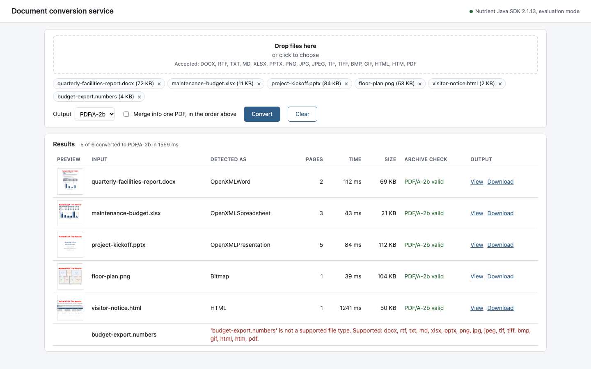
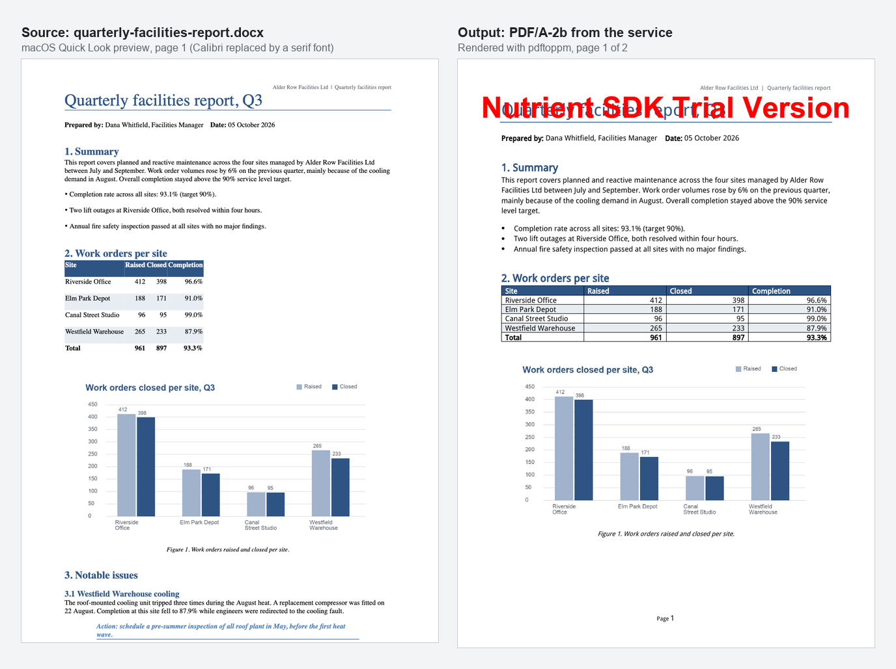
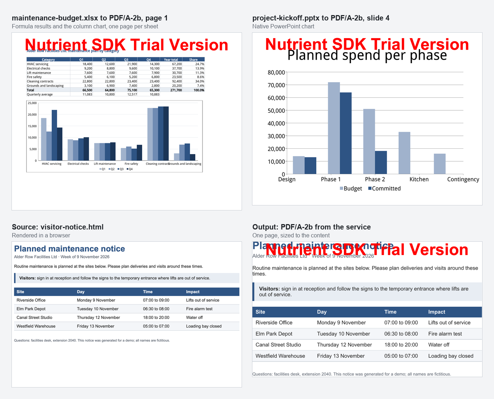

# Nutrient Office Conversion Service

A Nutrient.io demo that turns Word, Excel, PowerPoint, image and HTML files into PDF or PDF/A through a small REST microservice built with the Nutrient Java SDK and Spring Boot.



1. **Upload.** A client sends one or several files to the REST API (multipart). The upload page in the browser uses the same API.
2. **Check.** The service accepts only the listed file types and rejects empty files, unknown outputs and oversized uploads with a JSON error that names the file.
3. **Convert.** Each file is opened with `Document.open` and written with `exportAsPdf`. The SDK detects the real type from the content, so a renamed or damaged file gets a clear `unsupported_content` error.
4. **Merge (optional).** With `merge=true`, the files are appended in order with `PdfEditor.appendDocument` and written as one PDF.
5. **PDF/A (optional).** The output is a plain PDF, then that PDF is converted to the chosen PDF/A level (`PdfSettings.setConformance`). The result is checked with the SDK's `PdfValidator` and the answer is returned with the file.
6. **Return.** One PDF, a ZIP with one PDF per input, or a JSON summary with download links, page counts and conversion times.

Everything runs on the server. No cloud conversion service is called.

## Prerequisites

- Java 21
- Maven 3.9, or the included Maven wrapper (`./mvnw`)
- macOS, Linux or Windows on x64 or arm64. The SDK jar contains the native library for each of them.
- For HTML input: Google Chrome or Chromium installed. The SDK renders HTML with it.
- About 1 GB of free disk space: the SDK jar is about 360 MB and is unpacked to the temp folder at startup.
- Optional: Docker, to run the service in a container.
- Optional: Python 3.10 or later, only to regenerate the samples.

## Environment variables

Keys are only read from environment variables, never from code. Start from `.env.example`.

| Variable | Purpose | Default |
|---|---|---|
| `NUTRIENT_LICENSE_KEY` | Nutrient Java SDK license key | empty = evaluation mode |
| `PORT` | Port of the service | `8080` |
| `LC_ALL`, `LANG` | Locale of the process. Spreadsheet number formats follow it | system locale |
| `MAX_FILE_SIZE` | Largest accepted file | `50MB` |
| `MAX_REQUEST_SIZE` | Largest request, all files together | `200MB` |
| `MAX_FILES` | Most files per request | `20` |
| `CONVERSION_CONCURRENCY` | Documents converted at the same time | `4` |
| `JOBS_DIR` | Folder for the temporary job files | a folder in the system temp directory |
| `JOBS_RETENTION_MINUTES` | How long converted files stay available for download | `60` |

In evaluation mode the SDK writes a "Nutrient SDK Trial Version" watermark on every page. Everything else works.

The SDK formats spreadsheet numbers with the locale of the process. With `en_US.UTF-8`, `18400` in a cell formatted `#,##0` shows as `18,400`. If the locale is not set, the operating system default is used, which can give other separators or none.

## Build and run

```bash
cp .env.example .env
```

```bash
./mvnw package
```

```bash
set -a && source .env && set +a && java -jar target/office-conversion-service-1.0.0.jar
```

Open <http://localhost:8080>.

`./mvnw package` also runs the tests in `src/test`: health, DOCX to PDF/A-2b with validation, a three-file merge and the error cases. They call the real SDK.

To convert every sample from the command line while the service runs:

```bash
scripts/convert-samples.sh http://localhost:8080 pdfa-2b
```

### Docker

The image builds the jar, then runs it on Debian with Java 21, Chromium (for HTML) and metric-compatible fonts for Calibri, Cambria, Arial and Times New Roman.

```bash
docker build -t office-conversion-service .
```

```bash
docker run --rm -p 8080:8080 --env-file .env office-conversion-service
```

The image is about 2.3 GB, mostly the SDK and Chromium.

## Using the app

1. Drop files on the page, or click to choose them. The page lists the accepted types.
2. Choose the output: PDF, PDF/A-1b, PDF/A-2b, PDF/A-2u or PDF/A-3b.
3. Tick **Merge into one PDF** to get a single file, in the order of the list.
4. Click **Convert**. Each file gets a row with a preview of its first page, the type the SDK detected, the page count, the conversion time, the size, the PDF/A check and links to view or download the PDF. A file that cannot be converted gets a row with the reason. The other files are still converted.

Output pages next to the source. The Word report keeps its styles, table, picture, header and page number:



Spreadsheet formula results and the column chart, a native PowerPoint chart, and an HTML page next to its PDF:



## API

| Method and path | Description |
|---|---|
| `GET /api/health` | `{ status, sdk, sdkVersion, licenseMode, locale }` |
| `GET /api/formats` | Accepted input extensions and output formats |
| `POST /api/convert` | Converts and returns the result directly. Multipart fields: `files` (one or more), `output` (`pdf`, `pdfa-1b`, `pdfa-2b`, `pdfa-2u`, `pdfa-3b`, default `pdf`), `merge` (`true` or `false`, default `false`). Returns one PDF, or a ZIP with one PDF per file when several files are sent without `merge`. Any error rejects the whole request |
| `POST /api/jobs` | Same fields. Returns a JSON summary per file (`status`, `detectedType`, `pages`, `conversionMs`, `outputBytes`, `pdfa`, `download`, `view`, `thumbnail`) or the error for that file. Used by the upload page |
| `GET /api/jobs/{id}/files/{name}` | Downloads a converted PDF. Add `?inline=true` to open it in the browser |
| `GET /api/jobs/{id}/files/{name}/thumbnail` | PNG of the first page |

Response headers of `POST /api/convert`: `X-Conversion-Time-Ms`, `X-Output-Format`, `X-Page-Count` and, for PDF/A, `X-PdfA-Valid`.

Examples:

```bash
curl -o report.pdf -F files=@samples/quarterly-facilities-report.docx -F output=pdfa-2b http://localhost:8080/api/convert
```

```bash
curl -o bundle.pdf -F files=@samples/quarterly-facilities-report.docx -F files=@samples/maintenance-budget.xlsx -F files=@samples/floor-plan.png -F merge=true http://localhost:8080/api/convert
```

### Errors

Every error is JSON: `{ "error": "<code>", "message": "...", "file": "..." }`.

| HTTP | `error` | When |
|---|---|---|
| 400 | `no_files` | No file in the `files` field |
| 400 | `too_many_files` | More than `MAX_FILES` files |
| 400 | `empty_file` | A file has no content |
| 400 | `invalid_output` | Unknown `output` value. The response lists the valid ones |
| 400 | `invalid_request` | The request is not `multipart/form-data` |
| 413 | `file_too_large` | A file is larger than `MAX_FILE_SIZE` |
| 415 | `unsupported_format` | The file extension is not accepted. The response lists the accepted ones |
| 415 | `unsupported_content` | The SDK cannot open the content: empty, damaged, or saved with the wrong extension |
| 422 | `conversion_failed` | The SDK opened the file but the conversion failed. The response carries the SDK error code |
| 404 | `not_found` | The job file does not exist or has expired |

## Accepted files

| Family | Extensions |
|---|---|
| Word processing | DOCX, RTF, TXT, MD |
| Spreadsheet | XLSX |
| Presentation | PPTX |
| Image | PNG, JPG, JPEG, TIF, TIFF, BMP, GIF |
| Web page | HTML, HTM |
| PDF | PDF (to PDF/A, or to merge) |

Each type was converted to PDF and PDF/A-2b while building this demo. The SDK opens more types, for example DOC, XLS, PPT, ODT, EML, MSG, DWG and DXF. To accept them, add them to `InputFormat.java` and test them with your files.

## Results measured with the samples

Conversion times reported by the service (`X-Conversion-Time-Ms`) for PDF/A-2b, on an Apple Silicon Mac, after the first request. The time covers opening the file and writing the PDF/A; the validation adds 10 to 15 ms per file.

| Sample | Pages | macOS | Docker (linux/arm64) |
|---|---|---|---|
| `quarterly-facilities-report.docx` | 2 | 75 to 78 ms | 69 to 74 ms |
| `maintenance-budget.xlsx` | 3 | 37 to 43 ms | 32 to 37 ms |
| `project-kickoff.pptx` | 5 | 65 to 71 ms | 59 to 68 ms |
| `floor-plan.png` | 1 | 34 to 38 ms | 28 to 32 ms |
| `visitor-notice.html` | 1 | 967 to 970 ms | 491 to 559 ms |
| All five merged | 12 | 1.06 to 1.64 s | 0.72 to 0.87 s |

The first request after a start is slower while the engine loads: 0.6 to 0.8 s for the DOCX and about 2 s for the HTML file. The first PDF/A validation takes about 2 s.

Other checks:

- Every output of the five samples, and of the merge, passed the SDK validator and [veraPDF](https://verapdf.org) 1.28.2 for PDF/A-1b, 2b, 2u and 3b, on macOS and in Docker. The Office and HTML outputs keep their text layer.
- 40 parallel requests to plain PDF with `CONVERSION_CONCURRENCY=6` all returned valid PDFs, in 0.96 s in total.
- The extra types (RTF, TXT, MD, JPG, TIFF, BMP, GIF, PDF) were converted to PDF/A-2b and validated.

## Samples

The five files in `samples/` are generated by `samples/generate_samples.py`. Every company, person, site and figure in them is invented.

| File | Content |
|---|---|
| `quarterly-facilities-report.docx` | Title and heading styles, bullet and numbered lists, a shaded table, a chart picture, a quote, header and page number |
| `maintenance-budget.xlsx` | Three sheets, `SUM`, `AVERAGE`, `IF` and cross-sheet formulas, number and percentage formats, a column chart |
| `project-kickoff.pptx` | Title, bullets, a table, a native column chart and a picture |
| `floor-plan.png` | A drawn floor plan |
| `visitor-notice.html` | A self-contained page with CSS and a table |

To regenerate them:

```bash
pip install -r samples/requirements.txt
```

```bash
python samples/generate_samples.py
```

## Limitations

- **Evaluation mode.** Every page carries a watermark. The SDK banner says an evaluation session is limited to one hour; restart the service, or set a license key.
- **HTML pages.** The SDK renders the page with Chrome into a single PDF page the size of the content. Long pages are not split into A4 pages and `@page` CSS is ignored. Chrome or Chromium must be installed; the SDK starts a headless Chrome for each HTML conversion.
- **Spreadsheet formulas.** Formulas are not recalculated. The PDF shows the results saved in the file, as Excel saves them. A workbook written by a library that stores formulas without results (openpyxl, for example) shows empty cells until it is opened and saved in Excel.
- **Fidelity details seen with the samples.** The title of the Excel chart is not drawn. Built-in PowerPoint table styles are not applied, so the sample deck sets its table colors on the cells. Fonts that are not installed on the server are replaced; install the fonts your documents use.
- **PDF/A in two steps.** With SDK 2.1.13 on Linux, a direct PDF/A export of a multi-page Office document turned all text into outlines, so the PDF had no text layer. The service therefore writes a plain PDF first and converts that PDF to PDF/A, which keeps the text on macOS and Linux.
- **Previews.** The first-page preview renders all pages at 30 DPI and keeps the first one. That is fast for small files but costs time on long documents.
- **Not production hardened.** No authentication, files are kept in a temporary folder for one hour, and the executable jar is about 380 MB because the SDK ships its native library for every platform.

## Project layout

| Path | Content |
|---|---|
| `src/main/java/.../ConversionController.java` | REST API, upload checks, ZIP and job responses |
| `src/main/java/.../ConversionService.java` | All Nutrient Java SDK calls: convert, merge, PDF/A, validation, preview |
| `src/main/java/.../InputFormat.java`, `OutputFormat.java` | Accepted inputs and output levels |
| `src/main/java/.../NutrientSdk.java` | License registration at startup |
| `src/main/java/.../JobStore.java` | Temporary job folders and clean-up |
| `src/main/java/.../ApiExceptionHandler.java` | JSON errors |
| `src/main/resources/static/` | Upload page |
| `src/test/java/` | API tests with the real SDK |
| `scripts/convert-samples.sh` | Converts every sample through the API and prints the results |
| `samples/` | Fictitious samples and their generator |
| `Dockerfile` | Container image with Chromium and fonts |
